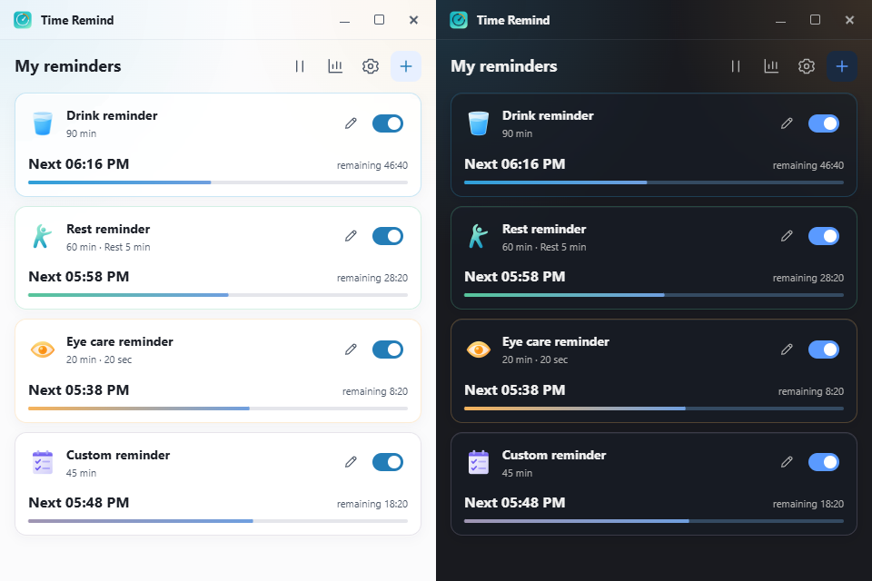
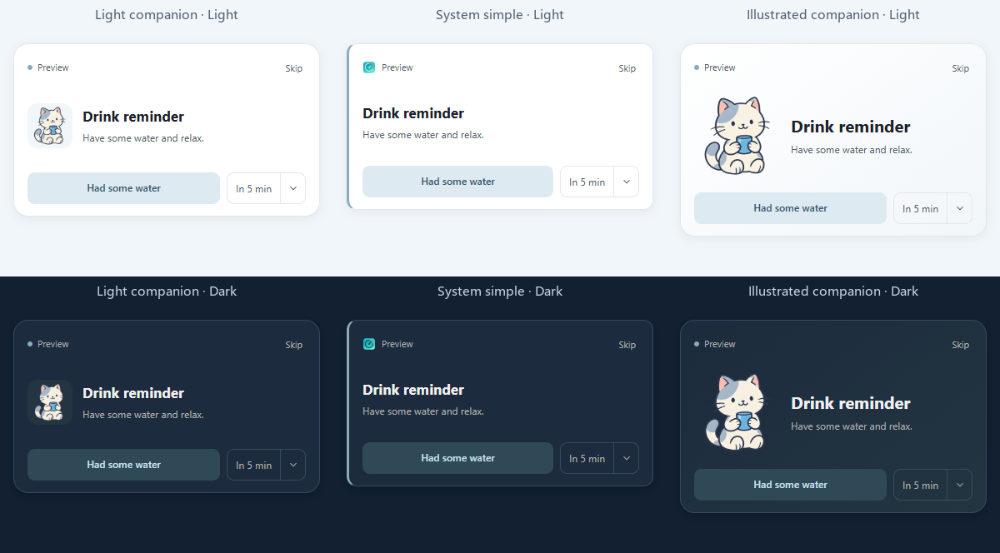
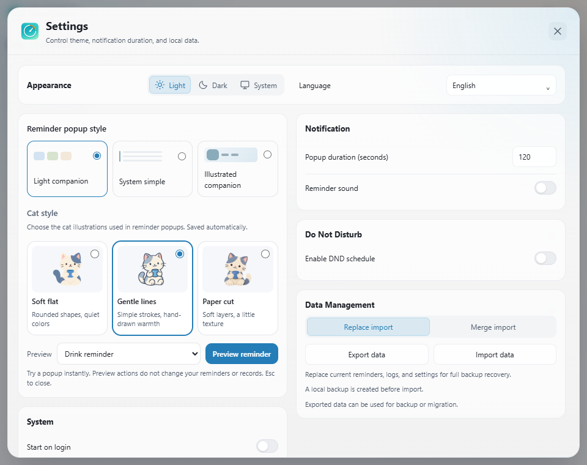

# Time Remind

**English** | [简体中文](README.zh-CN.md)

[](https://github.com/EthanHannn/time-remind/releases)
[](LICENSE)
[](#platform-status)

**Official site:** <https://ethanhannn.github.io/time-remind/> · [下载页](#install)

Time Remind is a lightweight desktop wellness reminder app for people who spend long hours at a computer. It helps you keep a steady rhythm for drinking water, taking short breaks, and resting your eyes.

## Screenshots

The current interface with example reminders. The app and Windows installer are available in 19 languages, with light, dark, and system themes. Built-in reminder text follows the selected language while preserving your edits.

### Main window

Keep track of drinking water, breaks, and eye care in light or dark mode.



### Reminder popups

Choose **Light companion**, **System simple**, or **Illustrated companion**, with soft category colors and three cat illustration styles. Snooze for five minutes directly, choose another saved duration, or collapse an active countdown.



### Settings

Choose your theme, language, popup style, sounds, and Do Not Disturb schedule. Wider windows display settings in two columns.



## Platform Status

| Platform | Status | Notes |
|----------|--------|-------|
| Windows | Supported and verified | The current release package targets Windows 10/11. |
| macOS | Community preview, not verified | Preview packages are published for open-source feedback. Tray, autostart, lock detection, and fullscreen behavior still need real-device validation. |
| Linux | Community preview, not verified | Preview packages are published for open-source feedback. Tray compatibility and desktop-environment behavior still need validation. |

Windows is the verified release platform. macOS and Linux packages are community previews and should not be treated as fully supported until platform capability fallback and real-device validation are complete.

## Features

- Default drink, rest, and eye care reminders.
- Custom reminders with configurable name, message, interval, and action countdown.
- Complete, postpone, skip, and timeout handling in the reminder popup.
- Do Not Disturb schedule.
- Windows fullscreen detection for presentations and games.
- Start on login and silent startup on supported platforms.
- System tray menu and background running.
- Daily stats, trend chart, and streak display.
- Configuration export and import.
- Light, dark, and system theme modes.
- Multilingual interface.

## Install

Download an installer from the [latest GitHub release](https://github.com/EthanHannn/time-remind/releases/tag/v0.1.12).

Recommended assets:

- Windows: `Time-Remind_0.1.12_windows_x64_nsis.exe`
- macOS preview: `.dmg` or zipped `.app` asset
- Linux preview: `.deb` or `.AppImage` asset

The Windows installer's **Startup settings** page lets you choose **Start with
Windows** and, optionally, **Start silently in the system tray**. Both default off
for a new installation. Silent startup only hides the window at Windows sign-in;
opening the app yourself still shows it. Upgrades keep your existing choices by
default, and you can change them later in the app's settings.

The Windows installer is not code-signed yet, so Windows may show an unknown publisher warning. macOS preview packages are not signed or notarized yet, so Gatekeeper may show a security prompt.

## Build From Source

Requirements:

- Node.js 22.13 or later
- pnpm 11 or later
- Rust stable
- Windows: Visual Studio Build Tools 2022
- macOS: Xcode Command Line Tools
- Linux: WebKitGTK, GTK 3, AppIndicator, librsvg, and related distribution packages

Common commands:

```powershell
pnpm install
pnpm lint
pnpm test
pnpm build
pnpm tauri dev
```

Package commands:

```powershell
# Windows
pnpm tauri build --bundles nsis

# macOS
pnpm tauri build --bundles app,dmg

# Linux
pnpm tauri build --bundles deb,appimage
```

Expected outputs:

- Windows: `src-tauri/target/release/bundle/nsis/Time Remind_0.1.12_x64-setup.exe`
- macOS: `src-tauri/target/release/bundle/macos/Time Remind.app`, `src-tauri/target/release/bundle/dmg/Time Remind_0.1.12_*.dmg`
- Linux: `src-tauri/target/release/bundle/deb/*.deb`, `src-tauri/target/release/bundle/appimage/*.AppImage`

Only the Windows NSIS installer is currently part of the verified release flow. macOS and Linux outputs are build targets for future validation.

Release rules:

- Version values in `package.json`, `src-tauri/tauri.conf.json`, release tags, and release notes must match.
- Public tags use `vMAJOR.MINOR.PATCH`, for example `v0.1.12`.
- Pushing a `v*` tag to GitHub automatically starts the release build workflow.
- Public installer names must include product name, version, platform, architecture, and package type.
- Windows remains the verified stable target.
- macOS and Linux outputs must be clearly marked as community preview assets until validation is complete.
- Every public installer should include a SHA256 checksum in the release notes or `SHA256SUMS.txt`.
- Do not replace an already published stable installer under the same tag; publish a new patch version instead.

## Data And Privacy

- All data is stored locally.
- No account is required.
- No network service is required for reminder data.
- Reminders, settings, logs, and import/export data are processed locally.

Use the export feature before reinstalling the system or moving to another device.

## Known Limitations

- Current version is `0.1.12 Beta`.
- Windows installer is not code-signed.
- macOS and Linux packages are community preview assets, not verified stable packages.
- macOS signing and notarization are not complete.
- Linux tray behavior varies by desktop environment.
- Non-Windows lock detection, fullscreen detection, tray behavior, and autostart still need real-device validation.
- macOS and Linux builds remain preview assets until the verification checklist is complete.
- Local custom audio files and fullscreen overlay mode are not included yet.

## Official Website

The site in [`site/`](site) is plain static HTML and CSS with no build step, plus one generated data file.

```powershell
# Refresh the release snapshot, download cards, and screenshots used by the site
node scripts/site-releases.mjs

# Preview locally
python -m http.server 8000 --directory site
```

- `site/index.html` is the Chinese page, `site/en/index.html` the English one.
- Everything between the `site:downloads` and `site:history` comment markers is generated by the script; edit the script instead of the generated blocks.
- Publishing: pushing a change under `site/` runs [`.github/workflows/pages.yml`](.github/workflows/pages.yml) and deploys to GitHub Pages.
- Self-hosting: [`site/Dockerfile`](site/Dockerfile) builds an Nginx image (`docker build -t time-remind-site site`) and [`site/nginx.conf`](site/nginx.conf) is ready to reuse on a normal VPS.

## Contributing

Issues and feedback are welcome. macOS and Linux support work is tracked as planned validation rather than an officially supported release.

## Changelog

See [CHANGELOG.md](CHANGELOG.md).
